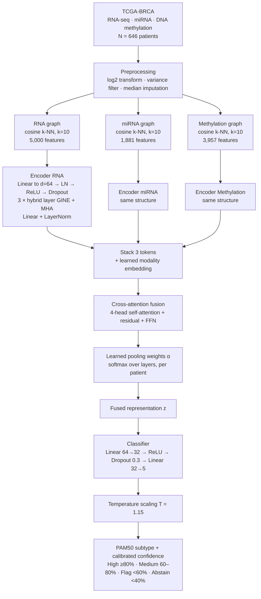
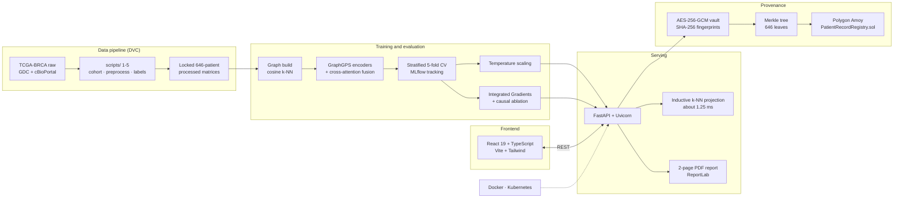

# BioNexus: Multi-Omics Graph Transformer for Breast Cancer Subtype Classification

> **Research platform for breast cancer molecular subtype (PAM50) classification from multi-omics TCGA-BRCA data, featuring GraphGPS-style encoders, cross-attention multimodal fusion, intervention-tested explanations, calibrated confidence with abstention, and tamper-evident audit proofs on the Polygon blockchain.**

[](https://python.org)
[](https://pytorch.org)
[](https://pyg.org)
[](https://fastapi.tiangolo.com)
[](https://react.dev)
[](https://typescriptlang.org)
[](https://polygon.technology)
[](LICENSE)

> **For Research Use Only (RUO). Not a diagnostic device.**

**Paper:** *Graph Transformer Fusion of Three Molecular Data Layers for Explainable Breast Cancer Subtype Classification* (under review).
**Authors:** Khushi Khanna, Anushka Mali, Madhavan Konar, Sanket Shitole, Kalyani Pampattiwar. Dept. of AI & ML, SIES Graduate School of Technology, Navi Mumbai, India.

---

## Table of Contents

1. [Executive Summary & The Problem](#executive-summary--the-problem)
2. [What BioNexus Does](#what-bionexus-does)
3. [Key Performance & Statistical Validation](#key-performance--statistical-validation)
4. [Model Architecture](#model-architecture)
5. [System Architecture](#system-architecture)
6. [The 646-Patient Cohort](#the-646-patient-cohort)
7. [Training Configuration](#training-configuration)
8. [Blockchain Security & Cryptographic Provenance](#blockchain-security--cryptographic-provenance)
9. [Limitations](#limitations)
10. [Technology Stack](#technology-stack)
11. [Interactive Web Application](#interactive-web-application)
12. [REST API Reference](#rest-api-reference)
13. [Quick Start Guide](#quick-start-guide)
14. [Repository Layout](#repository-layout)
15. [Scientific References](#scientific-references)
16. [Citation](#citation)

---

## Executive Summary & The Problem

### Clinical Motivation: Breast Cancer Heterogeneity
Breast cancer is not a single disease. It is a spectrum of distinct molecular entities with different clinical courses and therapeutic responses. The **PAM50 classification** (*Parker et al., 2009, JCO*) stratifies breast tumors into five intrinsic subtypes:

1. **Luminal A (LumA):** Hormone receptor positive ($ER^+$, $PR^+$), low proliferation. Favorable prognosis; managed mainly with endocrine therapy.
2. **Luminal B (LumB):** Hormone receptor positive with high proliferation. Poorer prognosis than LumA; often needs adjuvant chemotherapy in addition to endocrine agents.
3. **HER2-Enriched (Her2):** High expression of *ERBB2* (17q12 amplicon). Aggressive, but responsive to anti-HER2 therapies.
4. **Basal-Like (Basal):** Largely triple-negative, with frequent *TP53* mutations and basal cytokeratin expression (*KRT5*, *KRT14*, *KRT17*). Managed with cytotoxic chemotherapy or immunotherapy.
5. **Normal-Like:** Signature resembling non-malignant tissue; often low-cellularity specimens.

Subtype calling guides treatment choice between endocrine therapy, anti-HER2 agents and chemotherapy.

### The Multi-Omics Rationale
In routine practice the subtype is called from one layer, usually mRNA expression. Tumors are also shaped by:
- **Transcriptomics (RNA-seq):** functional gene expression.
- **Epigenomics (DNA methylation):** promoter hyper- and hypomethylation that control gene silencing.
- **miRNA:** post-transcriptional regulation.

The TCGA study showed that each layer carries partly different information. A tumor that looks ambiguous in one layer may be clearer in another, so combining layers is worth testing rather than assuming.

### The Gap
Graph-based multi-omics models add patient similarity, but they usually:
- pass messages only between close neighbours,
- fuse layers with fixed rules and rarely diagnose a fusion that underperforms a single layer,
- rarely test whether their explanations change predictions,
- are evaluated on the same graph they were trained on, with little reporting of calibration, abstention or inference for new patients.

---

## What BioNexus Does

1. **Patient-similarity graphs:** three cosine k-NN graphs ($k=10$) over 646 patients for RNA-seq (5,000 genes), miRNA (1,881) and DNA methylation (3,957 CpG probes).
2. **Hybrid local-global encoders:** GraphGPS-style layers combine edge-aware `GINEConv` message passing over neighbours with 4-head self-attention over all patients, so distant patients can contribute.
3. **Learned, patient-specific fusion:** 4-head cross-attention with modality embeddings and softmax pooling gives a weight per layer for every patient.
4. **Diagnosable fusion:** the learned weights exposed a fusion failure in an early model (see [The Diagnostic Paradox](#the-diagnostic-paradox--the-architectural-fix)).
5. **Intervention-tested explanations:** Integrated Gradients features are removed and the change in output is compared with removing random features (paired Wilcoxon and sign tests).
6. **Calibrated confidence and abstention:** temperature scaling ($T=1.15$) with confidence bands and an abstain option.
7. **Fast scoring of unseen patients:** an inductive k-NN projection scores a new patient in about 1.25 ms without rebuilding the cohort graph.
8. **Blockchain provenance:** diagnostic fingerprints and a cohort Merkle root are anchored on Polygon Amoy for a tamper-evident audit trail.
9. **Web suite and reports:** a React 19 dashboard and automated 2-page PDF reports.

---

## Key Performance & Statistical Validation

### 1. Classification Performance (5-Fold Stratified CV, pooled out-of-fold)

| Metric | Score |
|:---|:---:|
| **Accuracy** | **91.33% ± 1.85%** |
| **Macro-F1** | **0.8385 ± 0.0579** |
| **Weighted-F1** | **0.9124 ± 0.0150** |
| **Expected Calibration Error** | **0.105 → 0.048** after temperature scaling ($T=1.15$, 15 bins) |

### 2. Multi-Omics Fusion vs. Single-Omics Ablation

| Model | Accuracy (Mean ± Std) | Macro-F1 |
|:---|:---:|:---:|
| **BioNexus fused 3-omics (final)** | **91.33% ± 1.85%** | **0.8385 ± 0.0579** |
| First fusion model (before the two fixes) | 73.9% ± 9.0% | 0.711 |
| RNA-seq alone (best single layer) | 81.44% ± 8.36% | 0.8104 ± 0.0765 |
| miRNA alone | 74.92% ± 4.05% | 0.7242 ± 0.0361 |
| DNA methylation alone | 72.30% ± 3.18% | 0.7280 ± 0.0365 |

> **Reading these results honestly**
> - The fused model beats every single layer and pair on accuracy. The best pair reaches 84.9%, and the gain over it is 6.4 points.
> - The **+9.9-point gain over RNA alone is not statistically significant at the 5% level** (Welch $p = 0.056$), and the 2.8-point macro-F1 gain is not significant either ($p = 0.53$). Only five correlated folds are available, so these tests are indicative.
> - The best-supported claims are the **repair of the first fusion model** ($p = 0.011$) and the **lower fold-to-fold variance** (F-test $p = 0.013$).

### 3. Pooled Out-of-Fold Confusion Matrix (all 646 patients, 590 correct)

```
                       Predicted Subtype
              LumA    LumB    Her2   Basal   Normal  │ Recall
True LumA     330       9       0       2       1    │ 96.5%
True LumB       8     107       4       2       6    │ 84.3%
True Her2       1       2      34       1       1    │ 87.2%
True Basal      0       4       0     103       2    │ 94.5%
True Normal     3       4       1       5      16    │ 55.2%
─────────────────────────────────────────────────────
Precision     96.5%   84.9%   87.2%   91.2%   61.5%
```

| Subtype | Precision | Recall | F1 |
|:---|:---:|:---:|:---:|
| Luminal A | 96.5 | 96.5 | 96.5 |
| Luminal B | 84.9 | 84.3 | 84.6 |
| HER2-enriched | 87.2 | 87.2 | 87.2 |
| Basal-like | 91.2 | 94.5 | 92.8 |
| Normal-like | 61.5 | 55.2 | 58.2 |

- **Luminal A and Basal-like** are the easiest classes.
- **Luminal A vs. B** is the main confusion (9 and 8 patients), consistent with a continuum of hormone signalling and growth rate.
- **Normal-like** is the weakest class (13 of 29 misassigned) and is what pulls macro-F1 below accuracy. The other four subtypes have a mean F1 of 90.3%.

### 4. Intervention Test of Explanations

Integrated Gradients (50 steps, zero baseline) rank features per patient. The top 20 are set to zero and the change in the true-class logit is compared with removing 20 random features of the same layer, over 50 validation patients:

$$\Delta z = |z_c(\mathbf{x}) - z_c(\mathbf{x} \setminus \mathcal{F})|$$

| Metric | Top-20 attributed | Random 20 | Result |
|:---|:---:|:---:|:---|
| Median logit change | **0.0045** | 0.0010 | 4.5× larger |
| Mean logit change | **0.0246** | 0.0043 | 5.7× larger |
| Patients where attributed > random | **41 / 50 (82%)** | 9 / 50 | Sign test $p < 10^{-4}$ |
| Wilcoxon signed-rank | $W = 1137.0$ | | $p = 0.0007$ |

**Interpretation:** features flagged by attribution change the output more than random features, so the explanations are not arbitrary. The effect is clear but small in absolute size, and this test does not by itself show that the flagged features are biological drivers.

### 5. Comparison with Published Methods (indicative only)

| Method | Cohort | Accuracy | Weighted-F1 | Macro-F1 |
|:---|:---:|:---:|:---:|:---:|
| MOGONET (2021) | n=875 | 82.9 | 82.5 | 77.4 |
| MOGCL (2023) | n=875 | 85.3 | 85.1 | 82.3 |
| HyperCLSA (2025) | n=850 | 90.1 | 90.1 | 86.6 |
| MAGNET (2025)† | n=956 | 91.8 | 91.7 | 90.2 |
| **BioNexus (this work)** | **n=646** | **91.3** | **91.2** | **83.8** |

Ranks: accuracy 2nd of 5, weighted-F1 2nd of 5, macro-F1 3rd of 5. Cohorts and protocols differ, MOGCL and MAGNET are arXiv preprints, and †MAGNET was evaluated with real missing modalities, so this comparison is **indicative and does not show superiority**.

---

## Model Architecture

### Model pipeline



### Hybrid local-global layer

Each encoder applies three hybrid layers that update every patient from two sources at once:

$$\mathbf{h}_i^{(l+1)} = \mathrm{LN}\Big(\mathbf{h}_i^{(l)} + \mathrm{GINE}\big(\{\mathbf{h}_j^{(l)}, e_{ij}\}_{j\in\mathcal{N}(i)}\big) + \mathrm{MHA}\big(\mathbf{h}_i^{(l)}, \{\mathbf{h}_k^{(l)}\}_k\big)\Big)$$

- **GINE** (Graph Isomorphism Network with Edge features): edge-aware message passing over graph neighbours, with cosine similarity as edge weight.
- **MHA:** 4-head attention over *all* patients, so distant patients can also contribute.
- **LN:** layer normalisation.

### Cross-attention fusion

$$\alpha^{(m)} = \frac{\exp(\mathbf{w}^\top \mathbf{u}_m)}{\sum_{m'} \exp(\mathbf{w}^\top \mathbf{u}_{m'})}, \qquad \mathbf{z} = \sum_m \alpha^{(m)} \mathbf{u}_m$$

The weights $\alpha$ sum to one and show how much each layer contributed to a given patient's prediction.

### Component summary

| Component | Details |
|:---|:---|
| Patient graphs | Cosine similarity of standardised features; 10 nearest neighbours; undirected; similarity as edge weight; same 646 nodes in the same order across layers |
| Graph statistics | RNA / miRNA / methylation: 5,607 / 5,632 / 5,274 edges; mean degree 17.4 / 17.4 / 16.3; max degree 148 / 158 / 136; one connected component each |
| Neighbour purity | RNA graph 41.0%, miRNA 35.1%, methylation 34.1% (58.7% for LumA in the RNA graph), so neighbour voting alone is weak, which motivates learned fusion |
| Encoder | 3 hybrid layers, width 64, 4 attention heads, dropout 0.3 |
| Fusion block | One 4-head attention layer with residual and feed-forward network |
| Classifier | 64 → 32 → 5 |
| Parameters | **1,124,970 (~1.12M)** |

### The Diagnostic Paradox & The Architectural Fix
An early fusion model reached only **73.9%** accuracy, below the best single layer (RNA, 81.4%). Its learned weights gave **64.3%** to methylation even though methylation was weaker than miRNA alone. Two causes were found:
1. **Unreduced RNA dimensionality:** 60,660 raw genes fed to a linear layer with only 646 patients gave unstable embeddings. **Fix:** keep the top 5,000 most variable genes after $\log_2$ normalisation.
2. **Different encoder output scales:** one layer dominated the cross-attention pooling. **Fix:** add `LayerNorm(64)` to the output of every encoder.

These two fixes raised accuracy from **73.9% to 91.33%** and cut the fold-to-fold standard deviation from 9.0 to 1.85 points.

In the final model, **correct predictions use balanced weights** (RNA 25.2%, miRNA 37.5%, methylation 37.3%), while **wrong predictions put more weight on RNA** (27.9% on average, up to 77% for single patients). A lopsided weight pattern is therefore a useful warning sign.

---

## System Architecture



---

## The 646-Patient Cohort

The dataset is derived from **TCGA-BRCA** via the GDC Data Portal and the cBioPortal PanCancer Atlas. The data were generated by the TCGA Research Network, not by the authors.

### Cohort Construction Funnel

```
Total TCGA-BRCA PanCancer cohort (N = 1,084)
  │
  ▼  Stage 1: Multi-omics intersection (scripts/patient_cohort.py)
RNA-seq ∩ miRNA ∩ DNA methylation (N = 1,035)
  │
  ▼  Stage 2: Methylation platform selection (scripts/preprocess.py)
Kept Illumina HM450 (733 patients); dropped legacy HM27 (302 patients)
(HM27 probes cannot be merged with HM450 without losing over 94% of probes)
  │
  ▼  Stage 3: Platform bias check and PAM50 reconciliation (scripts/finalize_labels.py)
Dropped 87 patients without a confident PAM50 call
  │
  ▼  Stage 4: Final cohort (scripts/final_cohort.py)
3-omics matched + confident PAM50 label (N = 646)
```

### Final Cohort Distribution (N = 646)

| PAM50 Subtype | Patients | Percentage | Primary Clinical Strategy |
|:---|:---:|:---:|:---|
| **LumA** | **342** | 52.9% | Endocrine therapy |
| **LumB** | **127** | 19.7% | Endocrine + adjuvant chemotherapy |
| **Basal** | **109** | 16.9% | Cytotoxic chemotherapy / immunotherapy |
| **Her2** | **39** | 6.0% | Anti-HER2 therapy |
| **Normal** | **29** | 4.5% | Surgical excision, monitoring |
| **Total** | **646** | 100.0% | |

### Feature Matrix

| Omics Layer | Raw Features | Kept | Transformation | Filter |
|:---|:---:|:---:|:---|:---|
| **RNA-seq** | 60,660 | **5,000** | $\log_2(\text{TPM}+1)$ | Top variance |
| **miRNA** | 1,881 | **1,881** | $\log_2(\text{RPM}+1)$ | All kept |
| **DNA methylation** | 486,427 | **3,957** | $\beta$-value | Top variance, <20% missing |
| **Total** | 548,968 | **10,838** | | About 7.0 million readings |

Features missing in more than 20% of patients were dropped; the rest were filled with the median.

---

## Training Configuration

| Setting | Value |
|:---|:---|
| Optimiser | AdamW (learning rate $5\times10^{-4}$, weight decay $10^{-4}$) |
| Schedule | Cosine decay over 150 epochs, 10 warm-up epochs |
| Regularisation | Dropout 0.3 |
| Batching | Full graph |
| Early stopping | Macro-F1, patience 25 |
| Class imbalance | Class weights $w_c = N_{train} / (C \cdot N_c)$ computed on the training fold only |
| Splits | Stratified 5-fold; held-out fold labels masked from the loss; scores pooled over all out-of-fold predictions |
| Statistics | Welch's t-test (means) and F-test (variances) over five folds; 95% CI for accuracy 89.0–93.6% |

> **Note:** the graph is transductive, meaning all 646 patients are in the graph during every pass.

---

## Blockchain Security & Cryptographic Provenance

Diagnostic outputs can feed treatment decisions, so BioNexus adds a tamper-evident audit trail on **Polygon**. This layer is an engineering extension of the research model.

### Core Security Principles
1. **No raw data on-chain:** no genomic data, clinical notes or patient names are stored on-chain. Identifiers are pseudonymized with SHA-256.
2. **AES-256-GCM patient vault:** diagnostic records and omics inputs are encrypted at rest (PBKDF2-derived keys; `src/bio_nexus/security/patient_vault.py`).
3. **Merkle batch anchoring:** all 646 fingerprints form a binary SHA-256 Merkle tree (`merkle_tree.py`). One 32-byte root anchors the whole cohort in **a single transaction**.
4. **Tamper detection:** verifying one patient needs an $O(\log N)$ Merkle proof (about 10 hashes, no gas). Changing any value changes the leaf hash, breaks the Merkle path and triggers a **TAMPER DETECTED** alert.

### On-Chain Proof (Polygon Amoy Testnet)

| Parameter | Value |
|:---|:---|
| **Network** | Polygon Amoy Testnet (Chain ID 80002) |
| **Smart Contract** | [`0xE771417C54c4968E7E324925a563a224BD16A30e`](https://amoy.polygonscan.com/address/0xE771417C54c4968E7E324925a563a224BD16A30e) |
| **Anchor Transaction** | [`0x9ac5e955a3809f504a7393c505bd85fe2c54114faba4a99519ba32d01768c1cd`](https://amoy.polygonscan.com/tx/0x9ac5e955a3809f504a7393c505bd85fe2c54114faba4a99519ba32d01768c1cd) |
| **Cohort Merkle Root** | `0x8d3e8633b1e0fc0d8e3cecddb19fed2e29e7111a488b4b9d1cac3b6871375ffd` |
| **Block Number** | `49,153,585` |
| **Patients Anchored** | 646 / 646 in one batch |

> The blockchain proves a record **has not changed since it was anchored**. It does not prove that the model's prediction is correct.

---

## Limitations

- **Label circularity:** PAM50 labels are derived from mRNA expression, so RNA is favoured and the benefit of the other layers may be understated or partly circular.
- **Single cohort:** only TCGA-BRCA was used and no external validation was done. **METABRIC** is the planned test.
- **Not significant vs. RNA alone:** the accuracy gain over RNA alone ($p = 0.056$) and the macro-F1 gain ($p = 0.53$) are not significant at 5%.
- **Optimistic bias:** the graph is transductive (held-out patients' features are visible during training) and early stopping watched validation-fold macro-F1, so scores may be slightly optimistic.
- **Normal-like class:** only 29 patients and 55% recall, so macro-F1 trails accuracy.
- **Small explanation effect:** attributed features change the output more than random ones, but the absolute effect is small.
- **Inductive inference:** the speed of the k-NN projection is reported, but its **accuracy on held-out patients was not evaluated**.
- **Statistics:** t- and F-tests use five correlated folds and are indicative only.
- **Not a medical device:** research use only.

---

## Technology Stack

| Domain | Technology | Purpose |
|:---|:---|:---|
| **Deep Learning & Graph AI** | PyTorch 2.3+ | Tensor computation and custom modules |
| | PyTorch Geometric 2.5+ | `GPSConv`, `GINEConv`, graph data structures |
| | Captum 0.7+ | Integrated Gradients attributions |
| | scikit-learn 1.4+ | Cosine k-NN graph construction, stratified 5-fold CV |
| | NetworkX 3.2+ | Graph metrics, degree distributions, purity analysis |
| **Backend & Serving** | FastAPI 0.111+ / Uvicorn 0.30+ | Asynchronous REST API |
| | Pandas 2.2+ / NumPy 1.26+ / PyArrow 15+ | Omics matrix handling, parquet I/O |
| | Pydantic v2 | Request/response contracts |
| | ReportLab 4.0+ | 2-page clinical PDF reports |
| **Frontend** | React 19, TypeScript 5, Vite 8 | Web application |
| | Tailwind CSS v4 | Styling |
| | Recharts 3 + D3.js 7 | Charts, heatmaps, network views |
| | Lucide Icons | Iconography |
| **Cryptography & Blockchain** | Web3.py 6.18+, eth-account | Polygon RPC, transaction signing |
| | Solidity ^0.8.20 | `PatientRecordRegistry.sol` |
| | Cryptography (Python) | AES-256-GCM, PBKDF2 |
| **MLOps** | MLflow 2.14+ | Experiment tracking, model registry |
| | DVC | Data pipeline (`dvc.yaml`) |
| | Docker, Kubernetes | Container build and deployment |
| | pytest | Unit, regression and API contract tests |

---

## Interactive Web Application

The clinical suite (`frontend-new/`) provides these views:

| Route | View | Key Capabilities |
|:---|:---|:---|
| `/` | **Dashboard** | Cohort statistics, model accuracy, service health, recent diagnoses |
| `/patient-analysis` | **Patient Deep Dive** | Predicted subtype, calibrated confidence, modality-contribution radar, top-20 gene attribution waterfall, blockchain verification |
| `/cohort` | **Cohort Analysis** | UMAP and t-SNE projections coloured by PAM50 or stage |
| `/graph-explorer` | **Graph Explorer** | Force-directed patient-similarity network with k-NN edges and node degrees |
| `/biomarkers` | **Biomarkers & Pathways** | Searchable table of genes, miRNAs and CpG probes with attribution rankings |
| `/model-insights` | **Model Insights** | Confusion matrix, per-subtype ROC and PR curves, calibration curves, ablations |
| `/live-case` | **Live Case Prediction** | Run real-time inference on cohort samples and inspect attributions and hashes |
| `/new-case` | **New Case Intake** | Upload a new patient profile and generate a PDF report |
| `/settings` | **Settings & Security** | API keys, role-based access (Admin / Operator / Viewer), Polygon status, Merkle batches |

---

## REST API Reference

The FastAPI service runs on port `8000`. Interactive docs are at `/docs`.

### Core Diagnostic Endpoints

| Method | Route | Description |
|:---|:---|:---|
| `GET` | `/api/health` | Liveness and readiness probe |
| `GET` | `/api/patients` | List all 646 cohort patients with PAM50 labels |
| `GET` | `/api/patients/{id}` | Patient profile with normalized omics values |
| `POST` | `/api/predict` | Predicted subtype, calibrated confidence and modality weights |
| `GET` | `/api/explain/{id}` | Integrated Gradients attributions per omics layer |
| `GET` | `/api/metrics` | Validation metrics, confusion matrix, ablations and test statistics |
| `GET` | `/v1/cases/{id}/report.pdf` | 2-page clinical PDF report |
| `POST` | `/v1/panel-predict` | CPU-friendly inference with a distilled 10-to-50 gene panel |

### Blockchain Provenance Endpoints

| Method | Route | Description |
|:---|:---|:---|
| `GET` | `/api/security/cohort/status` | On-chain anchor status of the cohort Merkle root |
| `POST` | `/api/security/cohort/anchor` | Anchor all 646 fingerprints in one transaction |
| `GET` | `/api/security/cohort/verify/{id}` | Merkle proof and tamper check for one patient |
| `GET` | `/api/security/patient/{id}` | On-chain audit receipt and PolygonScan link |

### Example request

```bash
curl -X POST http://localhost:8000/api/predict \
  -H "Content-Type: application/json" \
  -d '{"patient_id": "<ID>"}'
```

---

## Quick Start Guide

### Prerequisites
- Python 3.11+
- Node.js 18+ and npm
- Git

### 1. Clone the Repository
```bash
git clone https://github.com/bionexus-ml/bio_nexus.git
cd bio_nexus
```

### 2. Set Up Python Environment
```bash
python3 -m venv .venv
source .venv/bin/activate
pip install -e .
```

### 3. Generate the 646-Patient Cohort
You need the raw TCGA-BRCA files in `data/raw/` first (download from GDC and cBioPortal; check the TCGA data-use terms).
```bash
python3 scripts/patient_cohort.py     # Step 1: intersect omics layers
python3 scripts/preprocess.py         # Step 2: normalize and filter (HM450)
python3 scripts/extract_labels.py     # Step 3: extract PAM50 labels
python3 scripts/finalize_labels.py    # Step 4: filter labels, platform bias check
python3 scripts/final_cohort.py       # Step 5: lock the final cohort
```

### 4. Train and Evaluate
```bash
python3 -m bio_nexus.train            # stratified 5-fold CV
```

### 5. Start the Backend
```bash
python3 metrics_seed.py
env PYTHONPATH=src uvicorn bio_nexus.serving.api:app --host 0.0.0.0 --port 8000 --reload
```

### 6. Start the Frontend
```bash
cd frontend-new
npm install
npm run dev -- --port 5174
```
Open [http://localhost:5174](http://localhost:5174).

### 7. Docker (Optional)
```bash
docker-compose up --build
```

### 8. Tests
```bash
pytest tests/
```

---

## Repository Layout

```
BioNexus/
├── docs/
│   └── PROJECT_WRITEUP.md          Scientific and ML specification
│
├── scripts/                        Reproducible data pipeline
│   ├── patient_cohort.py           Step 1: sample sheets and omics intersection
│   ├── preprocess.py               Step 2: platform detection, log2, filtering
│   ├── extract_labels.py           Step 3: PAM50 label extraction
│   ├── finalize_labels.py          Step 4: label filtering, platform bias check
│   ├── final_cohort.py             Step 5: locked 646-patient cohort
│   └── deploy_polygon.py           Smart contract deployment for Polygon Amoy
│
├── contracts/
│   ├── PatientRecordRegistry.sol   On-chain Merkle root registry
│   └── PatientRecordRegistry.json  Compiled ABI
│
├── src/bio_nexus/
│   ├── data/                       Ingestion, preprocessing, normalization
│   ├── graph/                      Patient-similarity k-NN graphs
│   ├── encoding/                   GraphGPS hybrid encoder (GINEConv + global attention)
│   ├── fusion/                     Cross-attention fusion and learned pooling
│   ├── models/                     Classification head and temperature scaling
│   ├── interpretability/
│   │   ├── attribution.py          Multi-graph Integrated Gradients
│   │   ├── causal_ablation.py      Feature removal and logit-change calculation
│   │   └── statistical_validation.py  Wilcoxon and sign tests
│   ├── security/
│   │   ├── patient_vault.py        AES-256-GCM vault and SHA-256 fingerprints
│   │   ├── merkle_tree.py          Binary SHA-256 Merkle tree
│   │   ├── cohort_manager.py       Cohort batch Merkle manager
│   │   └── polygon_service.py      Polygon Amoy anchoring and verification
│   ├── serving/
│   │   ├── api.py                  REST endpoints
│   │   ├── ml_client.py            Inductive k-NN projection engine
│   │   └── report_pdf.py           2-page PDF report generator
│   └── train.py                    Stratified 5-fold training loop
│
├── frontend-new/                   React 19 + TypeScript web app
│   ├── src/{pages,components,api,lib}
│   ├── package.json
│   └── vite.config.ts
│
├── data/                           DVC-tracked: raw/, processed/, security/
├── configs/                        YAML experiment configs
├── tests/                          pytest suite
├── docker/                         Multi-stage Dockerfiles
├── k8s/                            Kubernetes manifests
├── pyproject.toml
└── dvc.yaml
```

---

## Scientific References

1. **Parker, J. S. et al.** (2009). *Supervised Risk Predictor of Breast Cancer Based on Intrinsic Subtypes.* J. Clin. Oncol., 27(8), 1160–1167.
2. **Cancer Genome Atlas Network.** (2012). *Comprehensive molecular portraits of human breast tumours.* Nature, 490(7418), 61–70.
3. **Rampášek, L. et al.** (2022). *Recipe for a General, Powerful, Scalable Graph Transformer (GraphGPS).* NeurIPS 2022. [arXiv:2205.12454](https://arxiv.org/abs/2205.12454)
4. **Hu, W. et al.** (2020). *Strategies for Pre-training Graph Neural Networks* (GINE). ICLR 2020.
5. **Sundararajan, M., Taly, A., & Yan, Q.** (2017). *Axiomatic Attribution for Deep Networks.* ICML 2017, 3319–3328. [arXiv:1703.01365](https://arxiv.org/abs/1703.01365)
6. **Guo, C. et al.** (2017). *On Calibration of Modern Neural Networks.* ICML 2017, 1321–1330. [arXiv:1706.04599](https://arxiv.org/abs/1706.04599)
7. **Wang, T. et al.** (2021). *MOGONET integrates multi-omics data using graph convolutional networks.* Nat. Commun., 12, 3445.
8. **Jiang, Y.-Z. et al.** (2019). *Genomic and Transcriptomic Landscape of Triple-Negative Breast Cancers.* Cancer Cell, 35(3), 428–440.


---

> **Clinical Disclaimer:** BioNexus is a computational biology and translational research platform. All classifications and attributions are for **Research Use Only (RUO)** and must not be used as standalone clinical guidance without validation by a qualified pathologist and clinical tumor board.