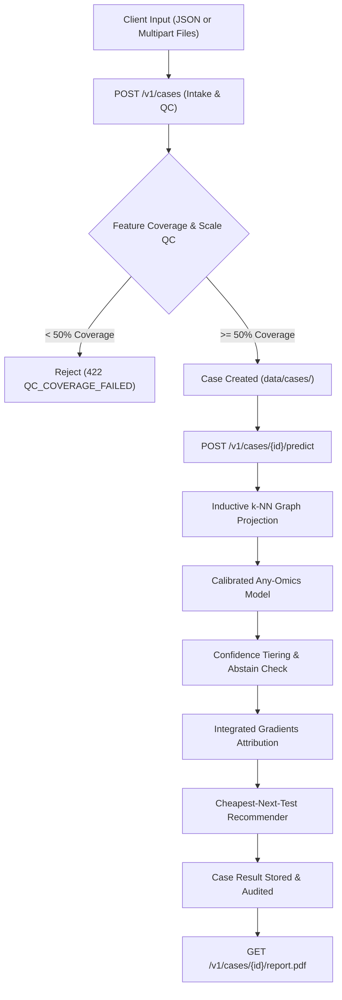

# BioNexus v1 Product API Documentation

The **BioNexus v1 Product API** extends the serving layer into a clinical research-grade diagnostic API.

## Architecture & Product Flow


---

## Authentication & Headers

All requests require an API key in the `X-API-Key` header (or `Authorization: Bearer <key>`).
In development mode (`BIONEXUS_DEV_MODE=true`), preconfigured keys with role-based access control (RBAC) include:
* `dev-admin-key`: Role `admin` (Full access, including case deletion)
* `dev-operator-key`: Role `operator` (Can create cases and run predictions)
* `dev-viewer-key`: Role `viewer` (Read-only access to cases, reports, and model cards)

---

## Endpoints Reference

### 1. Case Intake (`POST /v1/cases`)
Accepts either JSON or multipart file uploads with any subset of omics modalities (`rna`, `mirna`, `meth`).

#### Example Request (JSON):
```bash
curl -X POST "http://localhost:8000/v1/cases" \
  -H "X-API-Key: dev-operator-key" \
  -H "Content-Type: application/json" \
  -d '{
    "patient_ref": "PATIENT-BRCA-001",
    "specimen_type": "core_needle_biopsy",
    "rna": {
      "ESR1": 4.52,
      "PGR": 3.81,
      "ERBB2": 1.15,
      "MKI67": 1.45,
      "GATA3": 4.10,
      "FOXA1": 3.25,
      "EGFR": 0.85,
      "KRT5": 0.50,
      "KRT14": 0.32,
      "KRT17": 0.41
    }
  }'
```

#### Example Request (Multipart Upload):
```bash
curl -X POST "http://localhost:8000/v1/cases" \
  -H "X-API-Key: dev-operator-key" \
  -F "patient_ref=PATIENT-BRCA-002" \
  -F "specimen_type=primary_tumor" \
  -F "rna_file=@patient_rna.csv;type=text/csv"
```

#### Example Response (200 OK):
```json
{
  "case_id": "case_9d8f3e2a1b0c",
  "patient_ref": "PATIENT-BRCA-001",
  "specimen_type": "core_needle_biopsy",
  "status": "intake_qc_passed",
  "created_at": "2026-10-02T20:15:30.123456Z",
  "modalities_received": ["rna"],
  "qc": {
    "overall_status": "PASSED",
    "modalities_checked": ["rna"],
    "can_proceed": true,
    "summary_message": "Case QC passed: feature coverage and values are within expected quality parameters.",
    "modality_details": {
      "rna": {
        "modality": "rna",
        "status": "PASSED",
        "total_expected": 5000,
        "mapped_count": 3010,
        "coverage_pct": 0.602,
        "missing_pct": 0.398,
        "value_min": 0.32,
        "value_max": 4.52,
        "value_mean": 2.45,
        "likely_raw_counts": false,
        "warnings": [],
        "errors": []
      }
    }
  }
}
```

---

### 2. Inductive Prediction (`POST /v1/cases/{case_id}/predict`)
Runs inductive inference by projecting the case onto the reference graph cohort, executes calibrated subtype classification, extracts Integrated Gradients biomarker attributions, and computes cheapest-next-test recommendations.

#### Example Request:
```bash
curl -X POST "http://localhost:8000/v1/cases/case_9d8f3e2a1b0c/predict?top_k_biomarkers=5" \
  -H "X-API-Key: dev-operator-key"
```

#### Example Response (200 OK):
```json
{
  "case_id": "case_9d8f3e2a1b0c",
  "patient_ref": "PATIENT-BRCA-001",
  "predicted_subtype": "LumA",
  "confidence": 0.8845,
  "calibrated_probabilities": {
    "LumA": 0.8845,
    "LumB": 0.0721,
    "Her2": 0.0152,
    "Basal": 0.0185,
    "Normal": 0.0097
  },
  "confidence_tier": "high",
  "abstain": false,
  "abstain_reason": null,
  "modalities_used": ["rna"],
  "modality_weights": {
    "rna": 0.55,
    "mirna": 0.25,
    "meth": 0.20
  },
  "top_attributed_genes": {
    "rna": [
      {
        "gene": "ESR1",
        "feature_id": "ENSG00000091831",
        "attribution": 0.9852,
        "importance": 0.9852,
        "direction": "pushes toward predicted class",
        "layer": "rna"
      },
      {
        "gene": "GATA3",
        "feature_id": "ENSG00000107485",
        "attribution": 0.9678,
        "importance": 0.9678,
        "direction": "pushes toward predicted class",
        "layer": "rna"
      }
    ]
  },
  "next_test_recommendations": [],
  "model_version": "1.0.0",
  "preprocessing_version": "1.0.0",
  "qc_summary": {
    "overall_status": "PASSED"
  },
  "timings_ms": {
    "knn_projection_ms": 1.25,
    "inference_ms": 3.40,
    "attribution_ms": 2.10,
    "recommendation_ms": 0.05,
    "total_ms": 6.80
  },
  "disclaimer": "Research use only, not a diagnostic device."
}
```

---

### 3. Downloadable PDF Report (`GET /v1/cases/{case_id}/report.pdf`)
Generates a 1-2 page molecular diagnostic report.

```bash
curl -X GET "http://localhost:8000/v1/cases/case_9d8f3e2a1b0c/report.pdf" \
  -H "X-API-Key: dev-viewer-key" \
  -o BioNexus_Report.pdf
```

---

### 4. Cheap Gene-Panel Student Model (`POST /v1/panel-predict`)
Fast CPU-deployable graph-free scoring on a 10-50 gene panel.

```bash
curl -X POST "http://localhost:8000/v1/panel-predict" \
  -H "X-API-Key: dev-viewer-key" \
  -H "Content-Type: application/json" \
  -d '{
    "patient_ref": "PANEL-SAMPLE-001",
    "genes": {
      "ESR1": 5.2,
      "GATA3": 4.8,
      "PGR": 4.1,
      "ERBB2": 0.5,
      "KRT5": 0.2
    }
  }'
```

---

### 5. Cost-Accuracy Trade-off Simulation (`GET /v1/simulate/cost-accuracy`)
Returns the precomputed cost-accuracy curve for diagnostic planning.

```bash
curl -X GET "http://localhost:8000/v1/simulate/cost-accuracy?budget=1000" \
  -H "X-API-Key: dev-viewer-key"
```

---

### 6. Model Card (`GET /v1/model/card`)
Returns JSON specification of training data, architecture, cross-validation metrics, calibration ECE, and limitations.

```bash
curl -X GET "http://localhost:8000/v1/model/card" \
  -H "X-API-Key: dev-viewer-key"
```
